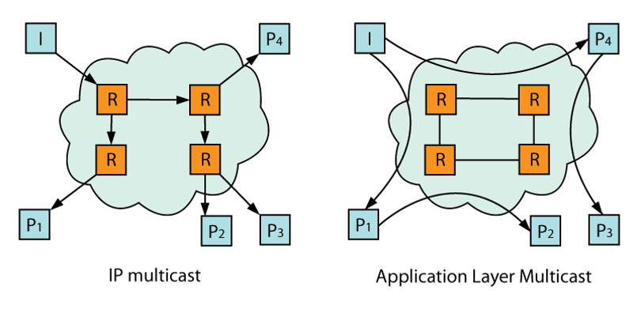
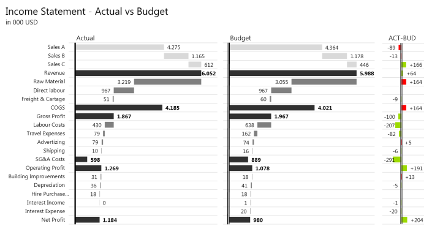

## Computers and Gaming
Computers have always been a big part of my life. It all started with gaming on the C64 and the [Sega Mega Drive][1]. The fantastic world that was offered to anyone that took the joystick in his hand is something I still love to remember to this day. Countless hours went by just by looking at those big pixels. 

[Image source][2]

But the journey didn't end at gaming. The curiosity led me deeper, I wanted more. I still remember getting a [Pentium 286][3] and asking for help with installing my first OS. At that time there weren't many people who knew how to do it. Before internet and Google the knowledge was spreading between friends. So it was slow. There weren't many books available but we did have an awesome [computer magazine][4]. Which introduced me to programming during the high school years.

## College and Research

I was one of the few people in my high school class that had absolutely no trouble choosing a [college][5]. I was (and still am) lucky that I found something that I feel passionate about and that I love to do. College went by too fast, especially the [student exchange][6] in Denmark. My focus narrowed down to programming, software development and algorithms, although almost any area dealing with computers still seems exciting.

After college I applied for the junior researcher position at the college and I spent the next couple of years at the [Laboratory of Algorithms and Data structures][7] where I really learned a lot! I was researching potential usage of [Steiner trees][8] in [Application layer multicast][9] protocols, published an article on the subject, developed a novel protocol but still need to put some more effort into finishing my PhD thesis. I also worked as a teaching assistant for Programming and Algorithms courses. I must admit I quite enjoyed it although I never envisoned myself as a teacher in my high school days.

## New adventures

With a sudden change I'm now the lead developer at [Zebra BI][11] which poses a completely different set of challenges. Challenges that require more investigation, more learning and are of course a lot of fun. Being in charge of development means making sure our code is [clean and maintainable][12]. That our [tests pass][13]. That we spend the effort on the [things that are important][14].

[Image source][15]

And it isn't only about software development. Developing a completely new product requires a different approach and mindset. [Running lean][16] and [agile][17] is the way to go. So apart from the new development challenges there are also business decisions that need to be discussed, customer that need to be handled and a lot more.

## Real life
Appart from computers I also like to [travel][18] and photograph. If I can combine the two (and I too seldomly do) that's even better. 

Until last year I also did a lot of sports, especially cycling and running. But last year and a half was just too frantic and I completely gave up. Not to mention that both my bicycles got stolen. But with the weather getting warmer outside and things calming down a bit my legs are starting to itch.

  [1]: https://en.wikipedia.org/wiki/Sega_Genesis
  [2]: https://www.dosgamesarchive.com/download/tyrian/
  [3]: https://en.wikipedia.org/wiki/Intel_80286
  [4]: https://joker.muzej.si/
  [5]: https://www.fri.uni-lj.si/
  [6]: https://www.sdu.dk/en/om-sdu/fakulteterne/teknik
  [7]: https://fri.uni-lj.si/en/laboratory/la-216
  [8]: https://en.wikipedia.org/wiki/Steiner_tree_problem
  [9]: https://en.wikipedia.org/wiki/Overlay_multicast
  [11]: https://zebrabi.com/
  [12]: https://www.amazon.com/gp/product/0132350882/ref=as_li_tl?ie=UTF8&camp=1789&creative=9325&creativeASIN=0132350882&linkCode=as2&tag=bezensek-20&linkId=HJ7AG6O5IAHTC457
  [13]: https://www.amazon.com/gp/product/1617290890/ref=as_li_tl?ie=UTF8&camp=1789&creative=9325&creativeASIN=1617290890&linkCode=as2&tag=bezensek-20&linkId=4DWL6VKAHR7SSTDP
  [14]: https://www.fastcompany.com/3026201/lessons-learned/how-pandoras-40-engineers-nabbed-70-million-monthly-users
  [15]: https://zebrabi.com/
  [16]: https://www.amazon.com/gp/product/1449305172/ref=as_li_tl?ie=UTF8&camp=1789&creative=9325&creativeASIN=1449305172&linkCode=as2&tag=bezensek-20&linkId=IBKF6R67I5GFWYL5
  [17]: https://en.wikipedia.org/wiki/Scrum_%28software_development%29
  [18]: https://poevropi.blogspot.com/
