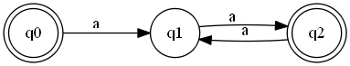
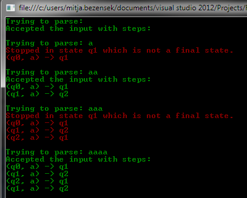

While I was working at the [Faculty of Computer and Information Science][1] I have implemented many of the standard algorithms from the famous Cormen's [Introduction to Algorithms][2]. Since I was a part of the Laboratory for algorithms and data structures that is to be expected. However, I have never implemented many of the great results from the Theory of Computation. 

This is why I decided to implement the finite state machine and the Turing machine in C# as an exercise. In this blog post I will start with the easier of the two, the [finite state machine (FSM)][3].

<!-- more -->

## Programming by wishful thinking

I will not bore you with the theory, since you can read all about it in the [wikipedia article][3], which explains the logic behind FSM better than I ever could. So I will just start with [programming by wishful thinking][4]. This is how I would like to consume an implementation of a deterministic FSM (DFSM):

``` csharp
    // Declaration
    var Q = new List<string>{"q0", "q1", "q2"};
    var Sigma = new List<char>{'a'};
    var Delta = new List<Transition>{
        new Transition("q0", 'a', "q1"),
        new Transition("q1", 'a', "q2"),
        new Transition("q2", 'a', "q1")
    };
    var Q0 = "q0";
    var F = new List<string>{"q0", "q2"};
    var dFSM = new DeterministicFSM(Q, Sigma, Delta, Q0, F);
```

As you can see I define the five components that make a DFSM: the states of the machine `Q`, the alphabet `Sigma`, the list of transitions `Delta`, the start state `Q0`, and the set of finish states `F`. I then construct the machine by passing the components to the constructor.

I expect the upper definition to construct the FSM that is visible on the image below. As you can see the machine accepts all the words with an even number of "a" characters.



After constructing the machine we wish to test if some input is a part of the machine's language:

``` csharp
    // Asking the machine if certain inputs are a part of it's language
    dFSM.Accepts("");
    dFSM.Accepts("a");
    dFSM.Accepts("aa");
```

I want the `Accept` method to print out if the machine accepted the input or not. Also I would like to see the steps that led to the finish state if the input was accepted.

## Transitions

With that, I had all the specification I needed, so I started by implementing the first thing the compiler complained about: the  `Transition` object.

The transitions define how we can move between the states. So the `Transition` class needs to hold the information about the `StartState`, the `Symbol` and the `EndState` of the transition. Appart from that I added a `ToString()` method that will be used later on.

``` csharp
    public class Transition{
        public string StartState { get; private set; }
        public char Token { get; private set; }
        public string EndState { get; private set; }

        public Transition(string startState, char token, string endState){
            StartState = startState;
            Token = token;
            EndState = endState;
        }
        
        public override string ToString(){
            return string.Format("({0}, {1}) -> {2}", StartState, Symbol, EndState);
        }
    }
```
## Deterministic finite state machine
Now that we have the `Transition`, we can start implementing the machine. Here is how the constructor might look like:

``` csharp
    public class DeterministicFSM{
        private readonly List<string> Q = new List<string>();
        private readonly List<char> Sigma = new List<char>();
        private readonly List<Transition> Delta = new List<Transition>();
        private string Q0;
        private readonly List<string> F = new List<string>();
    
        public DeterministicFSM(IEnumerable<string> q, IEnumerable<char> sigma, 
                                IEnumerable<Transition> delta, string q0, 
                                IEnumerable<string> f){
            Q = q.ToList();
            Sigma = sigma.ToList();
            AddTransitions(delta);
            AddInitialState(q0);
            AddFinalStates(f);
        }
    }
```

I just copied the list of states and the alphabet to the internal properties, but for the other three components we need some basic validation. For the transitions we want to verify that:

- they connect the states that are defined in `Q`,
- they use only symbols from `Sigma`.

There is an additional constraint with deterministic machine and that is: each state can only have one transition for a given symbol.

Considering all the requirements this is how the `AddTransitions` method might look like:

``` csharp
    private void AddTransitions(IEnumerable<Transition> transitions){
        foreach (var transition in transitions.Where(ValidTransition)){
            Delta.Add(transition);
        }
    }
    
    private bool ValidTransition(Transition transition){
        return  Q.Contains(transition.StartState) &&
                Q.Contains(transition.EndState)   &&
                Sigma.Contains(transition.Symbol) &&
                !TransitionAlreadyDefined(transition);
      }

     private bool TransitionAlreadyDefined(Transition transition){
        return Delta.Any(t => t.StartState == transition.StartState &&
                              t.Symbol == transition.Symbol);
     }
```

The validations for the start state and the finish states are much simpler. We only need to check if they are defined in Q:

``` csharp
    private void AddInitialState(string q0){
        if (Q.Contains(q0)){
            Q0 = q0;
        }
    }

    private void AddFinalStates(IEnumerable<string> finalStates){
        foreach (var finalState in finalStates.Where(
        			 finalState => Q.Contains(finalState))){
            F.Add(finalState);
        }
    }
```
## Accepting the inputs

That brings us to the meat of our DFSM implementation: the `Accepts` method. We will need to do the following:

- read the input symbol by symbol,
- try to find a transition from the current state that uses the current symbol,
- move to the next state defined by the found transition,
- if we have read all the symbols and have ended up in one of the finish states we can accept the input,
- in all other cases (no transition possible, ending up in non finish states) we don't accept the input.

The upper pseudo algorithm is implemented below. The main logic is in the foreach loop that reads the next symbol and tries to transition to the next state. If the transition is successful it records the current step in the steps variable. I have also added a simple `ConsoleWriter` class that deals with simple print outs to the console.
 
``` csharp
    public void Accepts(string input) {
        var currentState = Q0;
        var steps = new StringBuilder();
        foreach (var symbol in input.ToCharArray()) {
            var transition = Delta.Find(t => t.StartState == currentState &&
                                             t.Symbol == symbol);
            if (transition == null) {
                ConsoleWriter.Failure("No transitions for current state and symbol");
                ConsoleWriter.Failure(steps);
               return;
            }
            currentState = transition.EndState;
            steps.Append(transition + "\n");
        }
        if (F.Contains(currentState)) {
            ConsoleWriter.Success("Accepted the input with steps:\n" + steps);
            return;
        }
        ConsoleWriter.Failure("Stopped in state " + currentState + 
         					   " which is not a final state.");
        ConsoleWriter.Failure(steps);        
    }
```

## Conclusion
I have omitted some additional validations and the code behind the `ConsoleWriter` for the sake of brevity, but the full source code can be found at [GitHub][5].

Building the DFSM was quite fun! I have already implemented the non-deterministic one as well and will present it in one of the coming posts, and for sure I'll do the Turing machine as well.

Before I say goodbye let me show you a test run of the DFSM on the following inputs:
``` csharp
    dFSM.Accepts("");
    dFSM.Accepts("a");
    dFSM.Accepts("aa");
    dFSM.Accepts("aaa");
    dFSM.Accepts("aaaa");
```


  
  [1]: http://www.fri.uni-lj.si/en/
  [2]: http://www.amazon.com/gp/product/0262033844/ref=as_li_tl?ie=UTF8&camp=1789&creative=9325&creativeASIN=0262033844&linkCode=as2&tag=bezensek-20&linkId=EL57QKBNM5BB373B
  [3]: http://en.wikipedia.org/wiki/Automata_theory
  [4]: http://dsoguy.blogspot.com/2007/01/programming-by-wishful-thinking.html
  [5]: https://github.com/MitjaBezensek/DFSM
