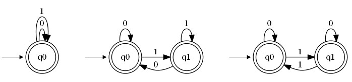
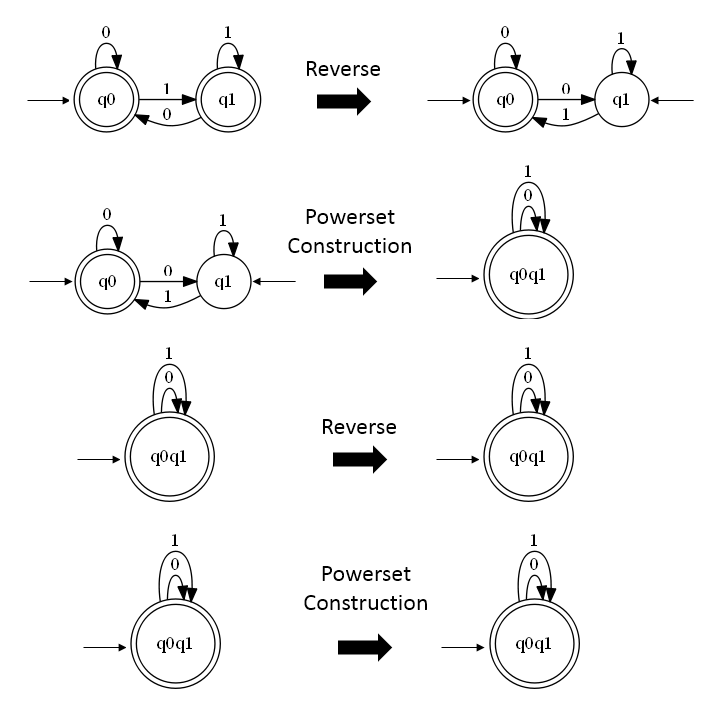

I have received a question about how to approach DFSM minimization in [one of the previous posts](https://bezensek.com/deterministic-finite-state-machine-implementation-in-c-number/). This is an attempt to answer that question.

## What is DFSM minimization?

First, let us consider what does it mean for two DFSM to be **equivalent**? Imagine having two DFSM that both accept the same input symbols. You then pass all the possible inputs to those two machines. If and only if the answers are the same for all the inputs then the two machines are equivalent. That is: they accept exactly the same inputs, even though their inner workings might not be the same.

This means that there are many equivalent DFSM. For example all three DFSM in the below picture accept the same input which can be written as a regular expression (0+1)<sup>*</sup>. 



The three DFSM vary in the number of states and also in the number of the transitions. Nonetheless, I hope you will agree with me that they all accept the same input. 

<!-- more -->

In this example case the machines are simple. But what would happen if the machines were complex - how would we determine if they are equivalent? 

The answer is minimization. Minimization **transforms** a machine **into an equivalent machine** that has **minimum number of states**.  We can then easily check if two DFSM are are equivalent. We just need to check if they have the same number of states and if all the transitions are the same.

## Why minimization 
Like I described in the previous paragraph you can use minimization to check the equivalence of the DFSM. Two other benefits (when using DFSM in programming) are:

- performance increase due to less states and transitions (faster input checking, less memory consumed),
- easier reasoning about the minimized machine since it has fewer moving parts.

## Two types of states to remove
When minimizing there are [two types of states](https://en.wikipedia.org/wiki/DFA_minimization) that we can either completly remove or merge with other states of the machine:

> - **unreachable states** are those states that are not reachable from the initial state of the DFA, for any input string,
> - **nondistinguishable states** are those that cannot be distinguished from one another for any input string.

## Unreachable states

First, let us look at an algorithm for finding the [unreachable states](https://en.wikipedia.org/wiki/DFA_minimization#Unreachable_states). The algorithm starts from the known reachable states which are the start states - the start states are always reachable. It then expands the list of reachable states by adding all the states that can be reached from the start states. It continues this expansion using the newly added states until it cannot add any new states to the list of reachable states. The states of the DFSM that did not end up in the list of reachable states are unreachable.

To me this algorithm feels like flooding the pipes: we have a system of pipes some of which are connected and some of which are not. We open the water and check which pipes did the water reach and which it did not reach.

Below is the algorithm in C#[^2]:  
```csharp
var reachableStates = new HashSet<string>{Q0};
var newStates = new HashSet<string>{Q0};
do{
	var temp = new HashSet<string>();
	foreach (var q in newStates){
		foreach (var c in Sigma){
	        var transition = Delta.Find(t => t.StartState == q &&
                                             t.Symbol == c);
            if (transition != null){
	            temp.Add(transition.EndState);
            }
        }
    }
    temp.ExceptWith(reachableStates);
    newStates = temp;
    reachableStates.UnionWith(newStates);
} while (newStates.Count > 0);
var unreachableStates = Q.Where(q => !reachableStates.Contains(q));
```
The part of the algorithm that finds the possible transitions from the new states is quite inefficient. For each new state it tries all the symbols from `sigma`. This causes us to loop over all the transitions for every symbol and every new state. A better solution is shown below. In it we are just selecting all the states that are reachable from the current state:

```csharp
foreach (var q in newStates){
	var reachableFromQ = Delta.FindAll(t => t.StartState == q)
							  .Select(t => t.EndState);
    temp.UnionWith(reachableFromQ);
}
```

Now that we have found all the unreachable states we can remove them (along with transitions to and from them):

```csharp
for (int i = Delta.Count - 1; i >= 0; i--){
	var transition = Delta[i];
	if (unreachableStates.Contains(transition.EndState) ||
	    unreachableStates.Contains(transition.StartState)){
	    Delta.Remove(transition);
    }
}
foreach (var unreachableState in unreachableStates){
	Q.Remove(unreachableState);
}
```

## Nondistinguishable states

And now for the hard part - the nondistinguishable states. Here, we will use [Brzozowski's algorithm for minimization](https://en.wikipedia.org/wiki/DFA_minimization#Brzozowski%27s_algorithm), which works like this:

> Reversing the edges of a DFA produces a non-deterministic finite automaton (NFA) for the reversal of the original language, and converting this NFA to a DFA using the standard powerset construction (constructing only the reachable states of the converted DFA) leads to a minimal DFA for the same reversed language. Repeating this reversal operation a second time produces a minimal DFA for the original language.

To implement the described algorithm we will need the following:

1. an algorithm that reverses a DFSM and produces a corresponding NDFSM,
2. an algorithm for powerset construction (this algorithm converts a given NDFSM into an equivalent DFSM)
3. an algorithm for detecting and removing unreachable states (see above).

### Reversing a DFSM

The algorithm for reversing a DFSM is quite easy to implement and is presented below [^3]:
```csharp
private NDFSM Reverse(DFSM d){
    var delta = new List<Transition>();
    foreach (var transition in d.Delta) {
        delta.Add(new Transition(transition.EndState,
                                 transition.Symbol,
                                 transition.StartState));
    }
    return new NDFSM(d.Q, d.Sigma, delta, d.F, d.Q0);
}
```

### Powerset construction

Here is [how I implemented the powerset constructions](https://bezensek.com/powerset-construction/) algorithm in my previous post[^4]:

```csharp
 private static DFSM PowersetConstruction(NDFSM ndfsm){
     var Q = new List<string>();
     var Sigma = ndfsm.Sigma.ToList();
     var Delta = new List<Transition>();
     var Q0 = new List<string> { string.Join(" ", ndfsm.Q0) };
     var F = new List<string>();

     var processed = new List<string>();
     var queue = new Queue<string>();
     queue.Enqueue(string.Join(",", ndfsm.Q0));

     while (queue.Count > 0){
        var setState = queue.Dequeue();
        processed.Add(setState);
        Q.Add(CleanupState(setState));

        var statesInCurrentSetState = setState.Split(',').ToList();
        foreach (var state in statesInCurrentSetState){
           if (ndfsm.F.Contains(state)){
              F.Add(CleanupState(setState));
              break;
           }
        }
        var symbols = ndfsm.Delta
           .Where(t => statesInCurrentSetState.Contains(t.StartState))
           .Select(t => t.Symbol)
           .Distinct();
        foreach (var symbol in symbols){
           var reachableStates =
              ndfsm.Delta
                 .Where(t => t.Symbol == symbol &&
                             statesInCurrentSetState.Contains(t.StartState))
                 .OrderBy(t => t.EndState).
                 Select(t => t.EndState);
           var reachableSetState = string.Join(",", reachableStates);

           Delta.Add(new Transition(
                                    CleanupState(setState), 
                                    symbol, 
                                    CleanupState(reachableSetState)));

           if (!processed.Contains(reachableSetState)){
              queue.Enqueue(reachableSetState);
           }
        }
     }
     return new DFSM(Q, Sigma, Delta, Q0, F);
  }

  private static string CleanupState(string state){
     return state.Replace(",", " ");
  }
```

### Putting it all together
Now that we have all the pieces we can combine them into Brzozowski's  algorithm:

```csharp
 public static DFSM MinimizeDFSM(DFSM fsm){
   var reversedNDFSM = Reverse(fsm);
   var reversedDFSM = PowersetConstruction(reversedNDFSM);
   reversedDFSM.RemoveUnreachableStates();
   var NDFSM = Reverse(reversedDFSM);
   var DFSM = PowersetConstruction(NDFSM);
   DFSM.RemoveUnreachableStates();
   return DFSM;
}
```

If you check the powerset construction algorithm (or read my previous post) you can see that the implementation has a nice property that it constructs a DFSM with only reachable states. Which is why we can remove the two calls to `RemoveUnreachableStates` method. The final algorithm:

```csharp
public static DFSM MinimizeDFSM(DFSM fsm){
   var reversedNDFSM = Reverse(fsm);
   var reversedDFSM = PowersetConstruction(reversedNDFSM);
   var NDFSM = Reverse(reversedDFSM);
   return PowersetConstruction(NDFSM);
}
```
And lets see how the minimization works on an example. This is how the four steps of the above minimization look like on one of the machines from the beginning .



So this is it for minimization. The source code can be found at [github](https://github.com/MitjaBezensek/DFSM_Minimization).

[^2]: You might want to check [one of my previous articles](https://bezensek.com/deterministic-finite-state-machine-implementation-in-c-number/) to check the DFSM implementation.

[^3]: If you read my previous article you might be wondering if those implementations will work with this reversal. The answer is no. The problem is that when we reverse a DFSM we are basically converting starting state to finish state and finish states to starting states. Which means there can be many starting states - a variant of the DFSM that my implementation does not cover. 

[^4]: With a few minor adjustements.
