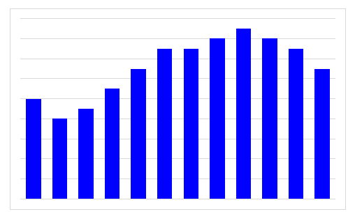

One of the strangest bugs I found in VSTO for Excel is the one that deals with assigning colors to the RGB property of the ChartFormat object. The ChartFormat object is used in multiple places of Excel. Let's look at an example:
``` csharp
Series series = Globals.ThisAddIn.Application.Selection;
series.Format.Fill.ForeColor.RGB = Color.Red.ToArgb();
```
For brevity's sake let's suppose that we have a series of a chart selected and we run the code above. One would expect that the color of the selected series would be set to red, but what happens is this:



<!-- more -->

And if we try to color the series blue then the result is red! 

## Red and Blue components of the RGB property are reversed

Since I intentionally used the red color that resulted in a blue series on the chart, some of you might have figured out the bug. But imagine yourself trying to apply some color from the middle of the RGB color range and consitently getting the wrong results.

Well the workaround is easy: just use a wrapper function that swaps the red and blue components of the color:

``` csharp
private void ApplyColorToSeries(){
    Series series = Globals.ThisAddIn.Application.Selection;
    series.Format.Fill.ForeColor.RGB = InteropColor(255, 0, 0);
}

public int InteropColor(int red, int green, int blue){
    return Color.FromArgb(blue, green, red).ToArgb();
}
```

After searching the web I found that this bug has already been mentioned on the [StackOverflow][1]. It is interesting that this has not yet been fixed in the newer versions of Excel. I have first stumbled upon this issue with the Excel 2007 interop library but it is still present in the current one. The only reason that comes to my mind is backwards compatibility with the numerous Excel solutions out there. So it seems we should just get used to it.

## Update:

It seems that this is not an Excel interop bug. Apparently the reason for this strange behavior is that VBA has a different representation of colors. For more see the comments.

  [1]: http://stackoverflow.com/questions/7423456/changing-an-excel-cells-backcolor-using-hex-results-in-excel-displaying-complet
