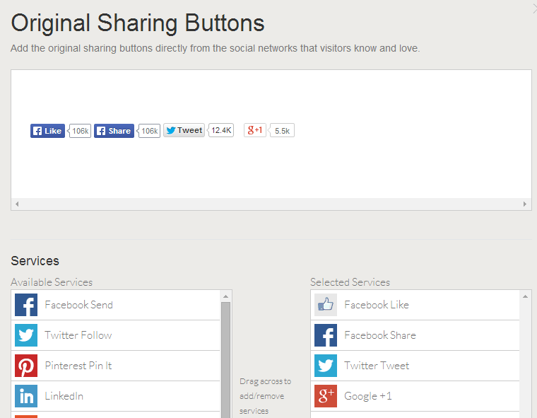

[Octopress][1] is a great blogging framework for (mostly) technical people. People that like to have everything about their blog in their control. People like me.

It's great to:

 - have your whole blog in version control,
 - forget about hosting since it's only a bunch of static pages and you can host them on [GitHub pages][2] [^1] ,
 - style your blog with the help of many [free themes](https://github.com/imathis/octopress/wiki/3rd-Party-Octopress-Themes),
 - easily customize and extend your blog by plugging in different pieces of functionality.

Today I'm going to show you how easy it is to add social share buttons below each of your posts. Let's get started.

 
<!-- more -->

Octopress by default supports the [Add this][4] social buttons. But it was a bit too limiting for my taste, so I removed it all and started from scratch.

The first thing to do is to create the account at Add This. This will allow you to customize your social buttons just the way you want them. I went for the "Original sharing buttons" and have set them like this:



There's many options to choose from, but not all are available for free.

Below the services selection window you will see the code that you should copy and paste to your blog. But where should you put it? I decided to put the social buttons below each blog post similar to what Octopress offers by default. So I needed to find the post template which is under `source/_layouts/post.html`. In it we can see that the social share buttons are already rendering beneath the article template:


``` ruby
    <article class="post" itemscope itemtype="http://schema.org/BlogPosting">
    	
    </article>
    
    	
    
```


If you wanted you could have easily displayed the buttons even above the article just by copying the  `` on the top of the template. Or at any other place of your blog.

Because the sharing template is already rendering we just need to paste our code from Add this to `sharing.html` which is under `source/_includes/posts/sharing.html`:
``` javascript
<script type="text/javascript" 
	src="//s7.addthis.com/js/300/addthis_widget.js#pubid=yourPubId">
</script>
<div class="addthis_native_toolbox"></div>
```
We could have just pasted the code in the unless block, but I think that separating the parts is a better idea. It makes our site more modular and its easy to reuse the modules / partials / templates in different parts of our blog. 

If we now regenerate the files we should see the social buttons beneath every blog post. Another nice thing about this is that if we wish to change how our buttons looks or if decide we wish to add some other buttons we only need to update our template at the Add this webpage and our buttons will update all across our site!

If you don't want to use Add This you can use this same logic for any other buttons you wish to add. 

[^1]: GitHub pages run on [Jekyll](http://jekyllrb.com/) that is at the core of Octopress.

  [1]: http://octopress.org/
  [2]: https://pages.github.com/
  [3]: https://github.com/shashankmehta/greyshade
  [4]: http://www.addthis.com/
