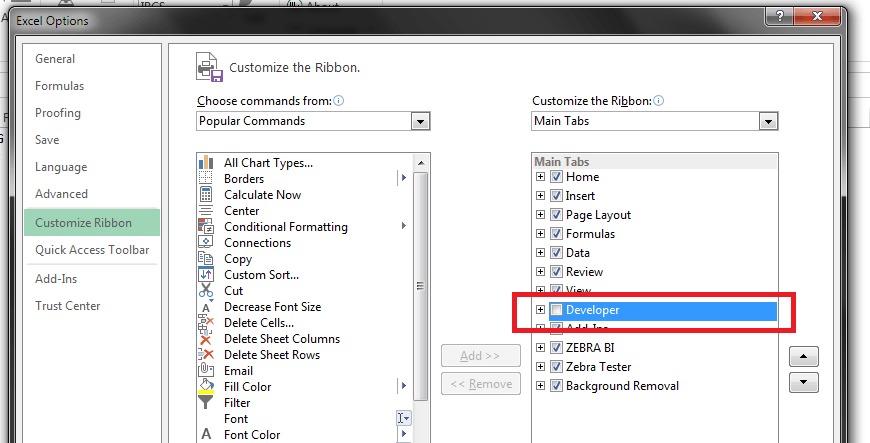
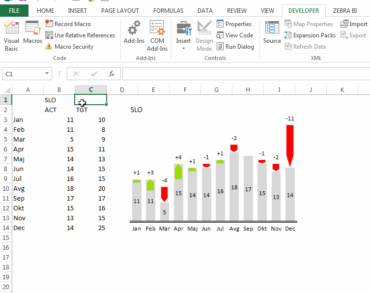
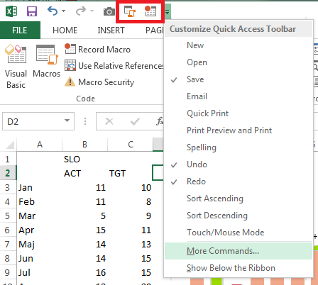

I am starting a category called "excel Excel" which will contain useful tips and tricks for Excel. It will be mostly directed towards Excel developers and power users.

## How do I [blank] in Excel?
[StackOverflow][1] is full of questions like: 
>"How do I change the color of a Chart Series in Excel in VBA / C#?"
 
While doing it manually is easy, the problem occurs when you wish to start talking to Excel from the code. This is not surprising, considering the number of different objects present in the [Excel Object Model][2]. One can spend an insane amount of time trying to figure out the exact five steps to reach the desired effect. It is easy to get lost in all the objects, and their methods and properties. Which is why I love the **macro recording option**.

<!-- more -->
After learning about it you will be able to do all the tasks you already know how to do manually in code as well. Well, almost all. I'll write about this in a future post. 

The primary use of macro recording is to **automate repetitive tasks**. You just start the recording, perform the task and stop the recording. After that you can replay the recorded macro as many times as you wish. And not only that, you can also **see all the steps** that were performed in code! 

## How to record a macro
First of all I recommend that you show the Developer ribbon tab. You can do this under File | Options | Customize Ribbon, where you need to check the Developer ribbon tab:

After enabling the tab you gain access to macro recording and viewing options. You are now ready to record your first macro:

 1. Click on the Record macro button under Developer tab 
 2. Perform the selected task, like changing a color of a Chart Series 
 3. Stop the macro recording 
 4. View the results 

As you can see at the end of the animation all of the steps that I performed during the recording are saved in the macro. It is now easy to find the object / property you need. I use this extensively, almost every day. It mainly serves as a way of finding the specific object / property to set, after which I use the Intellisense to explore the options a bit further.

 **Tip:** 
 >If you will be using the described technique as much as I do, I even recommend adding it to the Quick Access Toolbar. Click on the arrows in the Toolbar, Select More commands and then add Record macro and View macro commands to your Toolbar:
 
 

  [1]: http://stackoverflow.com/
  [2]: http://msdn.microsoft.com/en-us/library/wss56bz7.aspx
