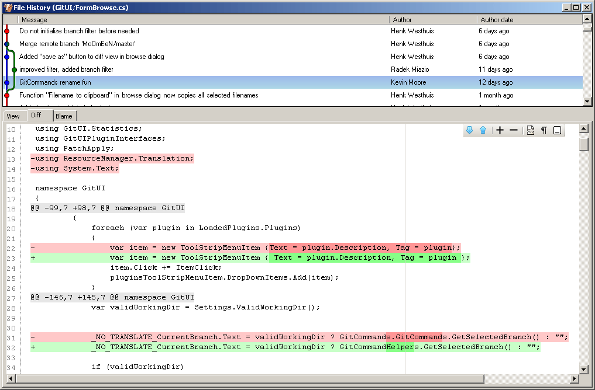
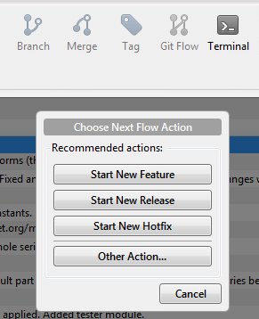

Source code needs to be under [version control][1], period. When it comes to deciding which system to use, [Git][2] is one of the options. There are many [heated debates][3] which one is the best, but let's not go into that. All of them do their job, so it mostly comes down to personal preference. I like Git.

[Image source][4]

<!-- more -->
## Git in Visual Studio

In January 2013 the Visual Studio team [announced][5] that Visual Studio will have Git support and you can download it from [here][6] if you want. You will need Visual Studio 2012 Update 2 at least. 

I have tried the extension but I don't recommend it just yet. It is still lacking many features and it seems very rushed. In a few iterations it might be worth to install it but for now I would say stay away. This is why I decided to discuss possible alternatives, namely: command line, Git Extensions and Source Tree.

## Command line
So how can you start using Git? The easiest way in terms of required software is the command line. First of all you need to [download][7] and install Git. After that you just need to [read the documenation][8] and you can immediately start using it from the command line. 

And that is a good way to start using it if you are not familiar with it. Since you have to type in all the commands you will think twice if this is the right thing to do. And you won't get overwhelmed by all the possible commands. You will learn one or two commands and really get to know those. For starters you just need `init` and `commit`. Soon after that you will want to save the source code on another computer, not only on your own. That's when `remotes`, `push` and `pull` come into play. And when you start to work in a team, sharing the code, you will need to learn about `branches` and maybe even about branching models like [GitFlow][9] for example. 

Does this work with Visual Studio. Absolutely. That's why I don't understand why so much fuss about Git being incorporated into Visual Studio. Many developers only use git from the command line. Some would even argue that that's the only way to use it. I understand that commiting directly from the IDE is probably faster and that visual representation of the branch tree is nice. However, writing a few additional lines every day sholdn't keep you from using Git!

## Git Extensions
The next option is a Visual Studio extension called [Git Extensions][10]. It's the only one of the three alternatives that I mention that is completely integrated into Visual Studio. After installing you get an additional toolbar in your workspace:

The most used commands are directly exposed on the toolbar, but you can open up a window where all git commands are only a click away. You can also see your branch tree and commit messages.

[Image source][11]

If you like the integrated way you might also want to check [Git Source Control Provider][12] which allows you to see the status of your files in the solution explorer. It makes it easy to see which files were newly added, which were changed,...

I've had some minor problems with Git Extensions. Sometimes the window crashed if I had it opened for too long. I also ran into some authentication problems when pushing to Bitbucket. This problem was solved by manually running their git-credentials-windstore executable. Apart from that I quite liked it. It is really rich with options and possibilities and also works remarkably well.

## Source Tree
The last option is a standalone desktop application called [Source Tree][13] from Atlassian. While the Mac version has been around for quite some while they have released the Windows version not so long ago. 

[Image source][14]

I must admit that lately I've been using Source tree the most. I really like the nice user interface, it is also very easy to keep track of multiple projects. And there is another little gem: it has support for Gitflow. So you can easily start new features, hotfixes, releases.

So until the Visual Studio team improves their extension I think any of the three proposed options is better. Once again it will come down to personal preference. Do you want visual control or do you like command line? Do you want to have integration with Visual Studio or is a standalone application also ok?

  [1]: http://www.joelonsoftware.com/articles/fog0000000043.html
  [2]: http://en.wikipedia.org/wiki/Git_%28software%29
  [3]: http://stackoverflow.com/questions/871/why-is-git-better-than-subversion/875#875
  [4]: http://nvie.com/posts/a-successful-git-branching-model/
  [5]: http://blogs.msdn.com/b/bharry/archive/2013/01/30/git-init-vs.aspx
  [6]: http://visualstudiogallery.msdn.microsoft.com/abafc7d6-dcaa-40f4-8a5e-d6724bdb980c
  [7]: http://git-scm.com/downloads
  [8]: http://git-scm.com/doc
  [9]: http://nvie.com/posts/a-successful-git-branching-model/
  [10]: https://code.google.com/p/gitextensions/
  [11]: https://code.google.com/p/gitextensions/
  [12]: http://visualstudiogallery.msdn.microsoft.com/63a7e40d-4d71-4fbb-a23b-d262124b8f4c
  [13]: http://www.sourcetreeapp.com/
  [14]: http://www.sourcetreeapp.com
